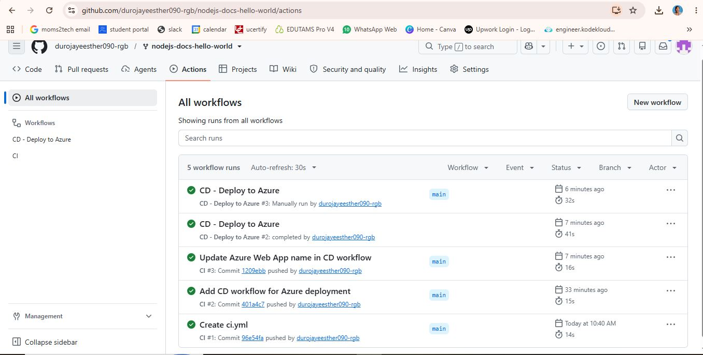
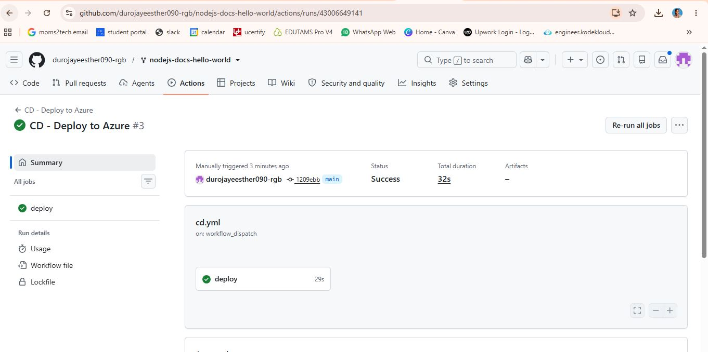
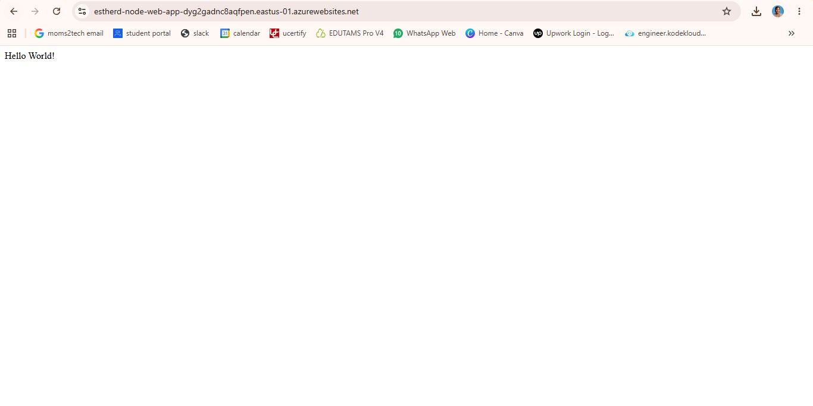
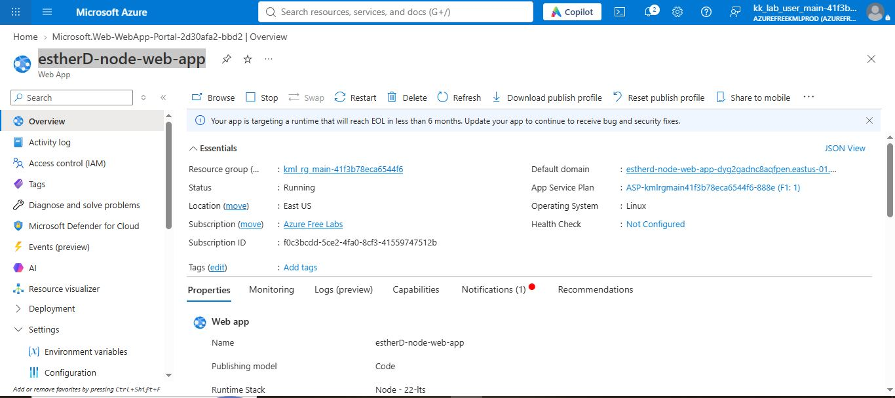

# Node.js Web App: CI/CD with GitHub Actions on Azure

A simple Node.js "Hello World" web app, forked from [Azure-Samples/nodejs-docs-hello-world](https://github.com/Azure-Samples/nodejs-docs-hello-world), with automated build and deployment to **Azure App Service** using GitHub Actions.

## Live app
https://estherd-node-web-app.azurewebsites.net

> Note: the Azure environment was created in a temporary KodeKloud playground, so the link may no longer be active. See the screenshots below for proof of deployment.

## How it works

```
Push to main -> CI workflow (install, test) -> passes -> CD workflow -> Azure App Service
```

| Workflow | File | Trigger | What it does |
|---|---|---|---|
| CI | `.github/workflows/ci.yml` | Push or pull request to `main` | Checks out code, sets up Node.js 20, installs dependencies, runs tests if present |
| CD | `.github/workflows/cd.yml` | After CI succeeds on `main`, or manually | Installs production dependencies and deploys the app to Azure App Service |

## Setup

1. **Fork** this repository.
2. **Create an Azure Web App** (Runtime: Node 20 LTS, OS: Linux).
3. In the Web App, go to **Settings > Configuration > General settings** and turn **SCM Basic Auth Publishing Credentials** **On**, then save.
4. On the Web App Overview page, click **Download publish profile**.
5. In GitHub, go to **Settings > Secrets and variables > Actions > New repository secret**:
   - Name: `AZURE_WEBAPP_PUBLISH_PROFILE`
   - Value: the full contents of the publish profile file
6. In `.github/workflows/cd.yml`, set `AZURE_WEBAPP_NAME` to your Web App name.
7. Push a change to `main`. Open the **Actions** tab to watch CI and then CD run.

## Screenshots

| Step | Screenshot |
|---|---|
| CI and CD runs (green) |  |
| CD deploy job |  |
| Live app |  |
| Azure Web App overview |  |

## Issues encountered and fixes

- **"Basic authentication is disabled" when downloading the publish profile:** fixed by enabling SCM Basic Auth Publishing Credentials in the Web App configuration.
  

## Tech stack
Node.js 20, GitHub Actions, Azure App Service (Linux)

## Author
Esther Durojaye
